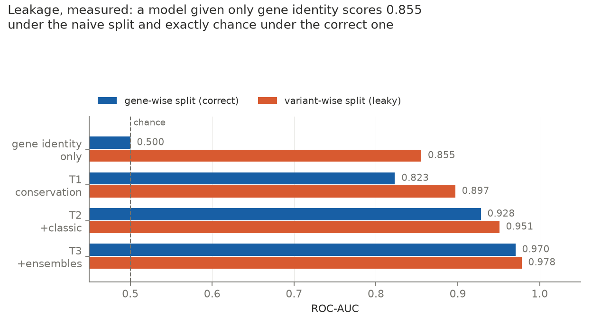
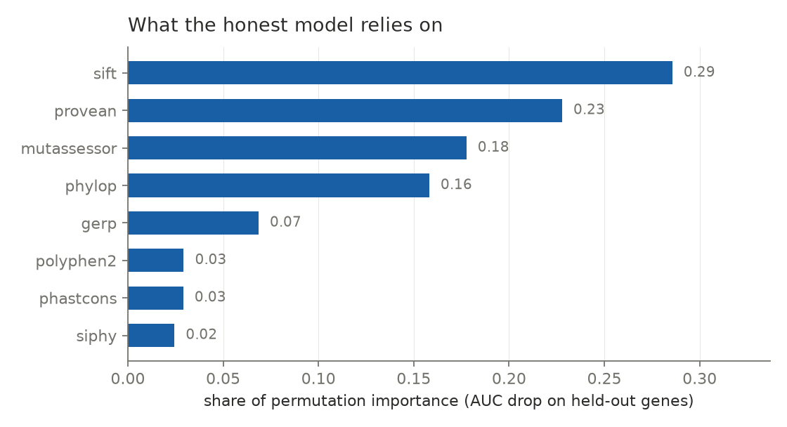
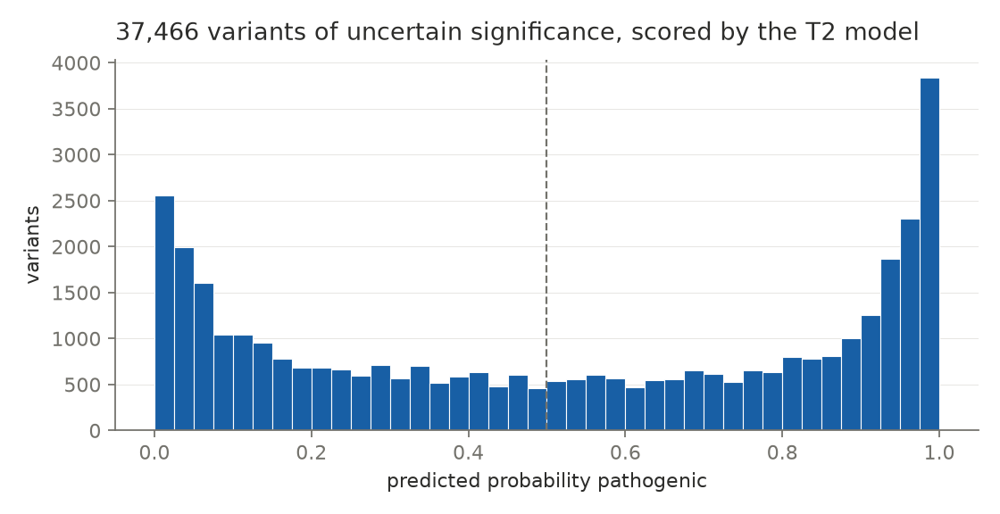

# Ion-channel missense variant classification, evaluated honestly

A classifier that predicts whether a missense variant in an ion-channel gene is pathogenic or benign, built from public ClinVar labels and precomputed dbNSFP annotations. The point of the project is less the classifier than the evaluation. Variant pathogenicity data has a strong group structure, and the standard way of splitting it produces numbers that look good and mean little. This repository measures that effect directly.

## Headline result

I built a model that is given **only the name of the gene a variant sits in** — no conservation, no predictor scores, no position, nothing about the variant itself. It cannot assess whether any individual variant is damaging. Anything it scores above chance is memorised gene structure.

|Split|ROC-AUC|Balanced accuracy|
|-|-|-|
|Variant-wise (standard, leaky)|**0.855**|0.760|
|Gene-wise (correct)|**0.500 ± 0.000**|0.500|

Under the usual random split, a model that knows nothing about variants looks like a competent classifier. Under a split that holds out whole genes, it falls to exactly chance in every fold.



## Why the split matters

ClinVar is not a random sample of variants. It records what was submitted, which reflects what was sequenced, which reflects who was clinically tested. The result is that the proportion of pathogenic variants differs enormously between genes, for reasons that are about clinical practice rather than biology:

|Gene|Labelled variants|Fraction pathogenic|
|-|-|-|
|CACNA1H|317|0.02|
|TRDN|40|0.05|
|GRIN2A|288|0.38|
|SCN5A|142|0.80|
|SCN1A|1,056|0.94|
|KCNQ2|380|0.96|

With a random variant-level split, every gene appears on both sides, so a model can learn "this is SCN1A, guess pathogenic" and be rewarded for it. That shortcut is useless in practice: the variants a predictor actually needs to handle are the ones without an answer yet, often in genes with few resolved examples.

All evaluation here uses `GroupKFold` with the gene as the group, so every variant from a given gene sits in exactly one fold and test-time genes are always unseen. This is the same principle as subject-wise cross-validation in my [EEG classifier](https://github.com/Aoe227/eeg-dementia-classifier), where epochs from one person would otherwise leak across the split.

## Data

**Labels — ClinVar** (`variant_summary.txt.gz`, September 2026 release). Filters, in order:

* GRCh38 rows only. ClinVar lists every variant once per genome build; keeping both would duplicate every variant and put identical copies on both sides of a split.
* Single-nucleotide variants in a 40-gene ion-channel panel (cardiac, neuronal, skeletal muscle, and CFTR).
* Review status with stated assertion criteria and no inter-submitter conflict: single submitter, multiple submitters with no conflicts, expert panel, or practice guideline.
* Missense only, parsed from the HGVS protein change. Nonsense variants (`Ter`) are excluded because they act through truncation rather than substitution and are almost always pathogenic, which would make the task trivially easier.
* Pathogenic / likely pathogenic → 1, benign / likely benign → 0. Variants of uncertain significance are held out entirely.
* Genes with fewer than 30 labelled variants are dropped. Each gene is a cross-validation group, and very small groups produce noisy or single-class folds where AUC is undefined.

Result: **6,383 labelled variants across 33 genes** (4,616 pathogenic, 1,767 benign; 72.3% pathogenic), plus **37,466 variants of uncertain significance**. In these genes, 85% of confidently reviewed missense variants are still unresolved.

**Features — dbNSFP**, queried through the MyVariant.info API in batches of 1,000 rather than downloading the full multi-gigabyte release. Twelve scores in three tiers:

|Tier|Features|What they are|
|-|-|-|
|T1 conservation|phyloP, phastCons (100-way vertebrate), GERP (91 mammals), SiPhy|Derived from cross-species alignments. No exposure to human disease labels.|
|T2 + classic predictors|SIFT, PolyPhen-2, PROVEAN, MutationAssessor|Older, mostly sequence-based predictors.|
|T3 + ensembles|CADD, REVEL, MetaSVM, AlphaMissense|Modern meta-predictors, some trained or calibrated on clinical variant data.|

Two handling details. A variant can fall in several transcripts, and dbNSFP returns one score per transcript; I keep the most damaging, which means each score needs a direction flag because SIFT and PROVEAN run the opposite way (lower is more damaging). Missing values are filled with the training-fold median inside the model pipeline, so test data never influences the imputation.

## Results

Random forest (400 trees, default hyperparameters, fixed seed), 5-fold cross-validation, mean ± standard deviation across folds:

|Model|Gene-wise AUC|Variant-wise AUC|Gap|
|-|-|-|-|
|T1 conservation|0.823 ± 0.037|0.897 ± 0.005|+0.074|
|T2 + classic|0.928 ± 0.018|0.951 ± 0.005|+0.023|
|T3 + ensembles|0.970 ± 0.006|0.978 ± 0.003|+0.008|
|Gene identity only|0.500 ± 0.000|0.855 ± 0.018|+0.355|

Single published scores on the same gene-wise folds: **REVEL 0.964**, **AlphaMissense 0.963**, CADD 0.875, phyloP 0.839.

Three things I take from this.

**The leakage gap is largest where features are weakest.** With conservation alone, the leaky split adds 0.074 AUC; with the full ensemble, 0.008. A naive split is most misleading in exactly the setting where it is most likely to be used: small projects with simple features.

**The honest numbers are also noisier.** Fold-to-fold standard deviation is five to seven times larger under gene-wise splitting. That spread is genuine between-gene heterogeneity, which the leaky split hides by giving every test fold a familiar mixture of genes. It inflates the mean and understates the uncertainty.

**My best model does not meaningfully beat REVEL.** T3 reaches 0.970 against REVEL's 0.964, within one standard deviation. Permutation importance shows why: in T3, AlphaMissense and REVEL account for 82% of the importance and every conservation feature drops to zero. T3 is effectively a wrapper around two published scores. I treat T2 as the model that is actually mine.



In T2 the importance is shared across independent sources of evidence — SIFT 0.29, PROVEAN 0.23, MutationAssessor 0.18, phyloP 0.16 — rather than collapsing onto one input.

### Variants of uncertain significance

The T2 model, trained on all labelled variants, scores the 37,466 held-out VUS:

|Score|Variants|Share|
|-|-|-|
|≥ 0.9|9,273|24.8%|
|0.7 – 0.9|5,877|15.7%|
|0.3 – 0.7|9,058|24.2%|
|0.1 – 0.3|6,056|16.2%|
|< 0.1|7,202|19.2%|

The mean score is 0.52, well below the 72% pathogenic rate of the training set, so the model is discriminating rather than defaulting to the prior. At gene level the ordering is sensible: VUS in SCN1A, SCN3A, SCN8A and SCN2A score highest, those in TRDN, HCN4 and KCNE1 lowest, consistent with their labelled base rates.



## Limitations

**Label circularity.** ClinVar classifications are expert judgements made under the ACMG/AMP framework, whose PP3/BP4 criteria explicitly allow computational predictions as evidence. Some labels were therefore assigned partly on the basis of the same kinds of scores used here as features. Separately, REVEL was trained on curated disease-mutation data that overlaps heavily with ClinVar, and AlphaMissense's classification thresholds were calibrated against ClinVar. Their scores on ClinVar labels are not independent evaluations. Conservation scores are not trained on disease labels, but curators may still have cited conservation as evidence, so T1 has a milder form of the same problem.

**The benchmark is easier than reality.** Excluding variants with conflicting classifications removes the cases experts find hardest. Reported performance is optimistic relative to real clinical use.

**Ascertainment bias.** Which variants appear in ClinVar depends on which genes are routinely tested and which populations are sequenced. That bias is the source of the gene-level base rates above, and it is not removed by the gene-wise split, only prevented from inflating the score.

**Informative missingness.** Feature coverage varies by gene — some genes are missing at least one score for every variant, others for 16% — and gene correlates with label, so missingness itself is weakly predictive. Median imputation stops the model from treating absence as a signal, but the coverage difference between genes remains.

**Evaluation choices.** `GroupKFold` balances fold sizes but not class composition; `StratifiedGroupKFold` would be the better choice. Results come from a single random seed, so the reported spread is fold variance rather than seed variance. Hyperparameters were deliberately left at defaults: tuning on the same folds used for reporting would bias the scores upward without nested cross-validation.

**VUS scores are rankings, not probabilities.** Random forest outputs are not calibrated, and the model learned from a set that is 72% pathogenic, whereas most VUS that are eventually resolved turn out to be benign. A score of 0.9 means "among the most pathogenic-looking", not a 90% probability.

**Scope.** Missense variants only, in 33 ion-channel genes. Transcript-level scores are collapsed to the most damaging transcript rather than the canonical one. Generalisation beyond this gene family is untested.

This is a methods demonstration, not a clinical tool.

## Reproduce

```bash
python -m venv .venv
.venv\\Scripts\\Activate.ps1            # Windows PowerShell
pip install -r requirements.txt

mkdir data
curl -L -o data/variant_summary.txt.gz https://ftp.ncbi.nlm.nih.gov/pub/clinvar/tab_delimited/variant_summary.txt.gz

python build_labels.py      # ClinVar -> data/labelled.csv, data/vus.csv
python fetch_features.py    # dbNSFP via MyVariant.info -> data/features_*.csv
python model.py             # tiered models, both splits, probe, baselines -> data/results.csv
python interpret.py         # permutation importance on held-out genes -> data/importances.csv
python predict_vus.py       # score the VUS -> data/vus_predictions.csv
python figures.py           # -> figures/*.png
```

ClinVar is updated monthly, so a later download will give slightly different counts.

## Repository layout

```
build_labels.py      ClinVar parsing, filtering and labelling
fetch_features.py    dbNSFP annotations via the MyVariant.info API
model.py             Tiered models under gene-wise and variant-wise splits
interpret.py         Permutation importance
predict_vus.py       Scores for variants of uncertain significance
figures.py           Figures
figures/             Result figures
data/                Downloads and intermediate files (not committed, except results)
```

## References

* Landrum MJ et al. ClinVar: improvements to accessing data. *Nucleic Acids Research* 48, D835–D844 (2020).
* Liu X et al. dbNSFP v4: a comprehensive database of transcript-specific functional predictions and annotations for human nonsynonymous and splice-site SNVs. *Genome Medicine* 12, 103 (2020).
* Xin J et al. High-performance web services for querying gene and variant annotation. *Genome Biology* 17, 91 (2016).
* Ioannidis NM et al. REVEL: an ensemble method for predicting the pathogenicity of rare missense variants. *American Journal of Human Genetics* 99, 877–885 (2016).
* Cheng J et al. Accurate proteome-wide missense variant effect prediction with AlphaMissense. *Science* 381, eadg7492 (2023).
* Richards S et al. Standards and guidelines for the interpretation of sequence variants (ACMG/AMP). *Genetics in Medicine* 17, 405–424 (2015).


